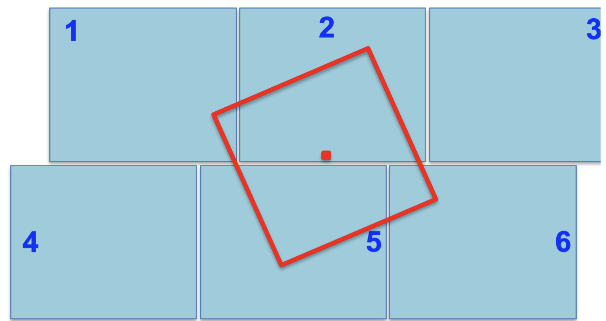
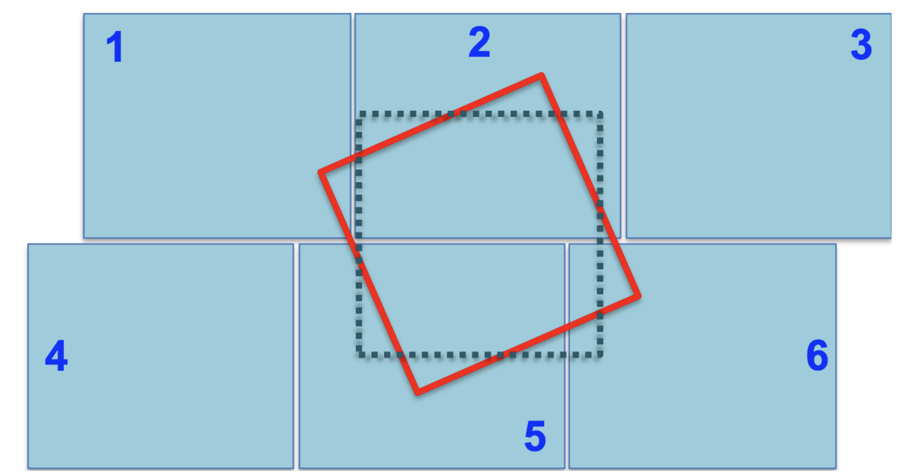
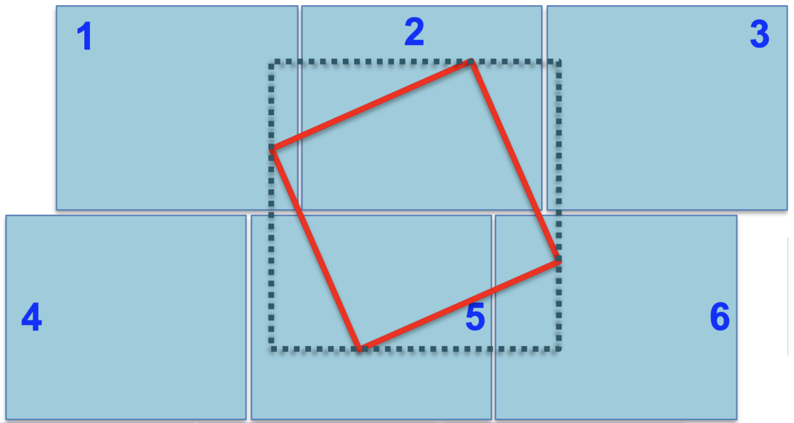
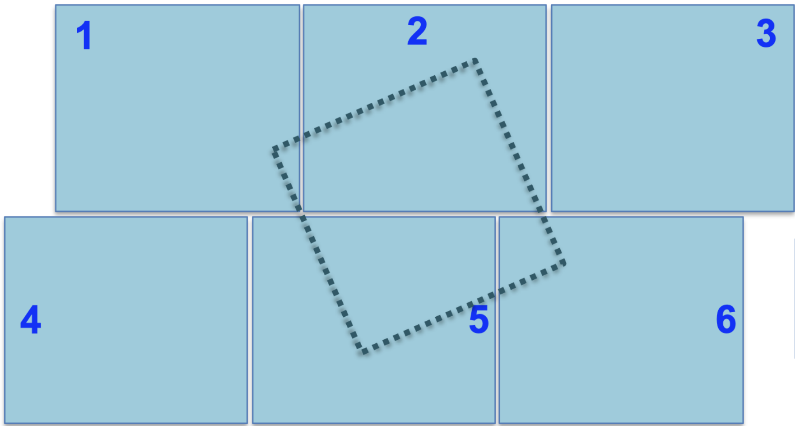

# SeaDAS and OCSSW Frequently Asked Questions

## General

<strong>Are SeaDAS and OCSSW the same thing?</strong>

**SeaDAS** is a processing, visualization and analysis software application that offers a graphical user interface (GUI) as well as many command line options. The underlying SeaDAS science processors (also known as **SeaDAS-OCSSW** or simply **OCSSW**) can be run either in the SeaDAS GUI or directly at the command line.

Due to the large size of the full package, SeaDAS is distributed without the science processors installed. The science processors may be installed either from within the SeaDAS GUI or directly from the command line.

Historically, and still in practice today, when the science processor software is run by ODPS it is called "OCSSW", and when it is run by the public it is often called the "SeaDAS science processors". This documentation uses the two names interchangeably.

<strong>Is a SeaDAS version number the same as an OCSSW version?</strong>

No. SeaDAS and its science processors have separate version tracking. The science processors are tracked using the **[OCSSW tag](https://git.sciencecloud.nasa.gov/oel/ocssw/-/tags)** version:

- **V- tags**: Operational versions
- **T- tags**: Test versions
- **R- tags**: Reprocessing versions (R-tags were used as release candidates during the R2022 multi-mission reprocessing and are unlikely to be used again)

A new OCSSW version is typically available to users within about two weeks of being compiled and delivered to operations.

SeaDAS evolves in conjunction with its science processors and ensures an installed OCSSW tag is compliant with the current SeaDAS version. When you open SeaDAS, a pop-up notification will tell you if a newer version of SeaDAS is available. After updating SeaDAS, you should also update the science processors to the latest compatible version. The SeaDAS GUI processor installer identifies the available OCSSW tags and indicates whether you have the latest compatible tag installed.

The science processors may also be installed separately from the SeaDAS GUI using the command line.

<strong>How can I replicate data produced by the Ocean Data Processing System (ODPS)?</strong>

SeaDAS can install the exact same OCSSW software used operationally by ODPS: the same code, the same configuration files, and the same look-up tables (LUTs). Users can replicate ODPS-produced data on their own machine, as long as they are using a matching OCSSW version/tag and the appropriate program settings.

<strong>What's the difference between the public SeaDAS GitHub and the OCSSW GitLab?</strong>

They are maintained by the same organization but serve different purposes:

- **[SeaDAS GitHub](https://github.com/seadas)**: Hosts the source code for the SeaDAS GUI tool.
- **[OCSSW GitLab](https://git.sciencecloud.nasa.gov/oel/ocssw/-/tags)**: Hosts the science software, which is publicly accessible.

You can also install the OCSSW source code directly through the SeaDAS installer without needing to interact with GitLab directly.

<strong>What are the core processors in OCSSW?</strong>

- **L1A/L1B generators** (sensor-dependent, e.g., `l1bgen_oci`): Convert raw or calibrated instrument data into calibrated, geolocated radiances/reflectances. Output is a Level-1 file.
- **l2gen**: Creates geophysical products and flags, applies atmospheric correction, uses ancillary data, and more. Output is a Level-2 file.
- **l2bin**: Transposes Level-2 pixels into bins and applies Level-2 flags. Output is a Level-3 binned file.
- **l3bin**: Aggregates one or more Level-3 binned files into another binned file, typically used for temporal binning (e.g., combining daily bins into a monthly file). Output is a Level-3 binned file.
- **l3mapgen**: Projects a Level-3 binned file into a chosen map projection, producing a displayable raster image in a chosen format. Output is a Level-3 mapped file.

Note: Processors for other satellite algorithms and missions (e.g., remote sensing tools developed outside the core processors) are maintained in their own separate repositories. These are not installed automatically when you install SeaDAS/OCSSW.

<strong>When would I need to use the processors instead of just downloading a standard Level-2/Level-3 product?</strong>

Mainly when you want to:

- Produce a non-standard product (l2gen can produce over 500 products, far more than what is distributed as standard)
- Bin and map across custom time spans, resolutions and/or granules
- Apply different Level-2 flags for masking and/or modify flag thresholds
- Map with different projections
- Apply custom bin schemes
- Create spatial, product, or wavelength subsets (extracts)
- Run diagnostics on a retrieval
- Test an alternate atmospheric correction approach
- Process a sensor that OCSSW supports in code but does not distribute operationally (e.g., Landsat, Sentinel, PRISM, EMIT)

<strong>Is there a list of supported missions/sensors?</strong>

You can see currently supported sensors in SeaDAS under **Install Processors**. Note that this list may not be fully comprehensive; some short-term/airborne mission support may only be visible in the OCSSW source code itself. SeaDAS may also be able to visualize files from sensors that are not processed with OCSSW, such as the PACE polarimeters. Details on what is included in a given OCSSW release can be found in the release notes on the **[OCSSW GitLab tags page](https://git.sciencecloud.nasa.gov/oel/ocssw/-/tags)**.

Here is a non-exhaustive list of OCSSW-supported sensors:

| Acronym | Full Name |
|---|---|
| avhrr | Advanced Very High Resolution Radiometer |
| czcs | Coastal Zone Color Scanner |
| goci | Geostationary Ocean Color Imager |
| hawkeye | HawkEye |
| hico | Hyperspectral Imager for the Coastal Ocean |
| meris | Medium Resolution Imaging Spectrometer |
| modisa | Moderate Resolution Imaging Spectroradiometer, Aqua |
| modist | Moderate Resolution Imaging Spectroradiometer, Terra |
| mos | Modular Optoelectronic Scanner |
| msis2a | Multispectral Imager, Sentinel-2A |
| msis2b | Multispectral Imager, Sentinel-2B |
| oci | Ocean Color Instrument |
| ocm1 | Ocean Color Monitor-1, ISRO (Indian Space Research Organisation) |
| ocm2 | Ocean Color Monitor-2, ISRO (Indian Space Research Organisation) |
| octs | Ocean Color and Temperature Scanner |
| olcis3a | Ocean and Land Colour Instrument, Sentinel-3A |
| olcis3b | Ocean and Land Colour Instrument, Sentinel-3B |
| olil8 | Operational Land Imager, Landsat 8 |
| olil9 | Operational Land Imager, Landsat 9 |
| osmi | Ocean Scanning Multispectral Imager |
| seawifs | Sea-viewing Wide Field-of-view Sensor |
| sgli | Second-generation Global Imager |
| viirsn | Visible Infrared Imaging Radiometer Suite, Suomi NPP |
| viirsj1 | Visible Infrared Imaging Radiometer Suite, NOAA-20 / JPSS-1 |
| viirsj2 | Visible Infrared Imaging Radiometer Suite, NOAA-21 / JPSS-2 |

<strong>Does OCSSW include processors beyond ocean color (e.g., polarimetry, atmosphere)?</strong>

OCSSW itself is primarily focused on ocean color and land, although it does produce some atmospheric quantities (e.g., AOT, water vapor). It also contains binning tools that have been generalized to bin other data types.

Related products such as aerosol and polarimetry retrievals are sometimes developed and distributed through their own separate code (e.g., **RemoTAP**, **FastMAPOL**, **UAA**, **Aquaverse**), not as part of OCSSW/SeaDAS.

Note: For the polarimeters HARP2 and SPEXone, the science processors only support processing to Level-3 or higher.

<strong>Are the OCSSW processors the same across all OB.DAAC missions?</strong>

Yes, OCSSW processors work with all OB.DAAC missions. Some products (e.g., polarimetry and OCI-specific atmosphere products) use separate dedicated tools. Note that some processors at Level-1 are mission specific.

<strong>What ancillary data creates a time lag in processing, and how long should I expect?</strong>

Roughly **6 weeks** under normal conditions. MERRA-2 reanalysis data, used in ancillary meteorological inputs for atmospheric correction, typically arrives in the third week of a given month, covering the previous month.

Refined (including monthly) processing requires both the relevant MERRA-2 data and a completed on-orbit calibration delivery. Once both are available, refined processing proceeds automatically and refined data replaces near-real-time (NRT) data.

<strong>How does OCSSW handle quality flags differently at Level-2 vs. Level-3?</strong>

- The processor **l2gen creates** the flags.
- The processor **l2bin applies** the flags.

Level-2 files contain flag data. Level-3 files do not contain flag data, since the flags have already been applied.

<strong>What does the OCSSW processor l2togrid do?</strong>

It takes a PACE OCI Level-2 file (`--ifile`) and a polarimeter Level-1C file (`--grid`) as inputs, and remaps the OCI Level-2 data onto the polarimeter's Level-1C grid.

<strong>What does "extracting" mean in OCSSW?</strong>

It is synonymous with subsetting, or subdividing: subsetting a file by variables (products) or by space. There are two main contexts:

1. **Level-1 extraction**: A smaller spatial subset of a Level-1 file is pulled out and kept for focused reprocessing. Useful for validation and vicarious calibration.
2. **Level-2/3 extraction**: Pulling out specific products or a specific region from a file, for purposes such as regional analysis.

<strong>With the command line version of OCSSW, do I need to source the OCSSW_bash.env script before running OCSSW commands, even if OCSSW is already installed?</strong>

Yes. If you do not source it, the processors will not run:

~~~bash
source $OCSSWROOT/OCSSW_bash.env
~~~

This script sets up required environment variables (data directory locations for each sensor, LUT paths, etc.). You only need to source it once per shell session, or you can add it to your login shell configuration. SeaDAS does this automatically and independently when run through the GUI.

---

## Level-2 Processing

<strong>When running l2gen, how do I know exactly what defaults will be applied?</strong>

By default, l2gen is configured the same way it is run operationally. To see precisely what parameters will be used for a given run at the command line, run `l2gen` with the `--dump_options` option. This option is fast and does not create an output Level-2 file; instead, it prints every available parameter, where its value came from, and what value will be used.

Note that default settings vary by the selected suite. The examples below limit the output to the `atmocor` parameter using `grep atmocor`:

~~~bash
l2gen ifile=PACE_OCI.20250625T095156.L1B.V3.nc suite=AOP --dump_options | grep atmocor
l2gen ifile=PACE_OCI.20250625T095156.L1B.V3.nc suite=SFREFL --dump_options | grep atmocor
~~~

Another example, limiting the output to `mask` parameters:

~~~bash
l2gen ifile=PACE_OCI.20250625T095156.L1B.V3.nc suite=AOP --dump_options | grep -E " mask"
~~~

<strong>How do I know what parameters were used to create a Level-2 file?</strong>

Inspect the output Level-2 file's NetCDF metadata. l2gen stores all input parameters used at runtime in its output file's metadata, in the `input_parameters` group attribute.

The examples below limit the output to the `atmocor` parameter, which differs between the AOP and SFREFL suites:

~~~bash
ncdump -h PACE_OCI.20250625T095156.L2.OC_AOP.V3_2.nc | grep atmocor
ncdump -h PACE_OCI.20250625T095156.L2.SFREFL.V3_2.nc | grep atmocor
~~~

Another example, limiting the output to `mask` parameters:

~~~bash
ncdump -h PACE_OCI.20250625T095156.L2.SFREFL.V3_2.nc | grep mask
~~~

<strong>Which masks are applied by default?</strong>

At Level-2:

- **ATMFAIL** is applied whenever atmospheric correction fails for a pixel. This is not really a configurable "mask" so much as an unavoidable consequence of the correction failing, so there is no option to disable it.
- **CLDICE** (cloud and ice) and **HILT** (high radiance) are masked by default but can be toggled.
- **LAND** masking depends on which suite you are using; it is not always on by default.
- **STRAYLIGHT** is not masked by default at Level-2.

Learn more about masks and flags on the **[Ocean Level-2 Flags page](https://oceandata.sci.gsfc.nasa.gov/ocl2flags/)**.

When running l2bin, the flags used depend on which suite is specified.

<strong>What's the purpose of processing "suites," and how are the options chosen?</strong>

A suite is a convenience bundle of configuration options (typically a list of products plus other settings) used to configure l2gen the same way it is run operationally (e.g., the AOP suite). Processing with a given suite reproduces the standard operational output.

Many processors, such as l2gen, l2bin and l3mapgen, use suites. Many extra suites are available that are not distributed by ODPS.

<strong>In the l2gen help output, defaults are shown as off/false/0. Are these interchangeable?</strong>

Yes. For boolean parameters, l2gen (and presumably all the processors) accepts the following interchangeably on the command line:

- `on` / `off`
- `1` / `0`
- `true` / `false`
- `yes` / `no`

<strong>Is there a master list of available algorithms, with details on how to run them and which missions they support?</strong>

There is no "master list" per se, but a command line tool called **get_product_info** can help you find this information. It returns information on a given product, such as short name, long name, description, scaling/display factors, reference citation and much more.

- Each product has a `cat_ix` (catalog index) value. If `cat_ix` is anything other than `-1`, the product can be created by l2gen.
- Each product has a `reference` entry. This usually points to a DOI and the paper describing the specific algorithm.

To display a list of all products for the OCI sensor:

~~~bash
get_product_info sensor=OCI -l
~~~

To display information on the `chlor_a` product for the OCI sensor:

~~~bash
get_product_info sensor=OCI chlor_a
~~~

Output of the above example:

~~~text
sensorName=OCI
fullProductName=chlor_a
description=Chlorophyll Concentration, OCI Algorithm
units=mg m^-3
palette=default
paramDesignator=none
paramWaveMin=-1
paramWaveMax=-1
standardName=mass_concentration_of_chlorophyll_in_sea_water
category=Derived
dataType=float
prefix=chlor_a
suffix=
algorithmName=
productName=chlor_a
cat_ix=229
prod_ix=-1
rank=2
fillValue=-32767
validMin=0.001
validMax=100
displayScale=log
displayMin=0.01
displayMax=20
scaleFactor=1
addOffset=0
flag_values=(null)
flag_meanings=(null)
reference=Hu, C., Feng, L., Lee, Z., Franz, B. A., Bailey, S. W., Werdell, P. J. and Proctor, C. W. (2019). Improving Satellite Global Chlorophyll a Data Products Through Algorithm Refinement and Data Recovery. Journal of Geophysical Research: Oceans, 124(3), 1524--1543. and O'Reilly, J. E. and Werdell, P. J. (2019). Chlorophyll algorithms for ocean color sensors - OC4, OC5 and OC6. Remote Sensing of Environment, 229, 32--47.
comment=(null)
titleFormat=Chlorophyll Concentration, OCI Algorithm
~~~

**A note on product-algorithm aliases:** Some products are aliases to other algorithms. For example, `chlor_a` is an alias whose underlying algorithm varies by sensor. Algorithms can also be called directly and unambiguously (e.g., `chl_oc4` for the OC4 4-band chlorophyll algorithm).

<strong>How do I know which aerosol mode will be used with a given suite (or l2gen run scenario)?</strong>

- For general help, run `l2gen` with no arguments at the command line and look for `aer_opt`.
- To see the actual aerosol options l2gen will use for a given run scenario, run `l2gen` with the desired `ifile` and `suite` and add `--dump_options`. Look for `aer_opt` in the text output.

**A general guide to the aer_opt parameter:**

- **0**: White aerosol. Aerosol reflectance derived from the "anchor" wavelength (`aer_wave_base`, typically 865 nm) is used for all wavelengths.
- **Positive value**: Use a single fixed aerosol model across all pixels (the value being the aerosol model to use), instead of having models dynamically determined for each pixel.

Here is a sample of some available models. A full list can be found in the runtime text output of l2gen (provided `atmocor=1` is the default or is specifically set). The first entry is the model number, `rh` is relative humidity, and `f` is the percentage of fine (small) particles:

~~~text
10, rh=50.000000, sd=5, alpha=2.185652, name=r50f95
11, rh=50.000000, sd=19, alpha=2.072113, name=r50f80
12, rh=50.000000, sd=50, alpha=1.736037, name=r50f50
13, rh=50.000000, sd=70, alpha=1.351452, name=r50f30
14, rh=50.000000, sd=80, alpha=1.055006, name=r50f20
15, rh=50.000000, sd=90, alpha=0.614437, name=r50f10
16, rh=50.000000, sd=95, alpha=0.293084, name=r50f05
17, rh=50.000000, sd=98, alpha=0.042913, name=r50f02
18, rh=50.000000, sd=99, alpha=-0.054214, name=r50f01
~~~

- **Negative value**: Indicates the aerosol scheme to use:
  - **-99**: No aerosol subtraction
  - **-1**: Classic Gordon & Wang two-NIR-band approach
  - **-2**: Near-IR correction
  - **-5**: Near-IR correction using a single specified model (used for sensors without two usable NIR bands, such as CZCS and HawkEye)
  - **-17 (MSEPS, multi-scattering epsilon)**: The modern, multi-scattering-capable version of the Gordon & Wang approach, used for most current missions
  - **-18 (MBAC, multiband atmospheric correction)**: Allows aerosol selection using more than two bands (defined by `mbac_wave`), Ibrahim et al., 2019

**Note for PACE OCI users:** Most traditional aerosol options are not compatible with OCI's default aerosol tables, because OCI uses PCA-based tables rather than the Gordon & Wang-style tables most options were designed around. For OCI, `aer_opt=-18` (MBAC) or a fixed aerosol model approach are the confirmed supported options.

---

## Level-3 Binning (l2bin and l3bin)

<strong>What does binning do, and how is it different from mapping?</strong>

**Binning** is the process of selecting and collecting valid data into defined geographic locations on a roughly equal-area grid. **Mapping** is the separate process of projecting binned data into a chosen map projection for display or analysis. A mapped product is generated from a binned product.

- **l2bin** takes a Level-2 file as input and produces a bin file.
- **l3bin** aggregates one or more existing Level-3 bin files into another bin file. It is primarily used for temporal binning (e.g., combining daily bins into a monthly file), but it can also combine data spatially.

This table illustrates the key similarities and differences between l2bin, l3bin and l3mapgen:

| Functionality | l2bin | l3bin | l3mapgen |
|---|---|---|---|
| Input | One or more Level-2 files | One or more Level-3 binned files | Level-3 binned file |
| Output | Level-3 binned file | Level-3 binned file | Level-3 mapped file or image file |
| Projection option | No (fixed) | No (fixed) | Yes |
| Applies Level-2 flags | Yes | No | No |
| Temporal subsetting | Yes | No | No |
| Spatial subsetting | Yes | Yes | Yes |
| Product subsetting | Yes | Yes | Yes |
| Binning scheme | Yes | Yes | No |
| Resolution | Discrete resolution | Discrete resolution and no upsampling | Any |
| Interpolation | Yes | No | Yes |
| Unit weight option | No | Yes | No |
| Median option | No | Yes | No |
| Data stored | Per bin: sum, sum of squares, weights, number of source Level-2 files, number of source Level-2 pixels | Per bin: sum, sum of squares, weights, number of source Level-2 files, number of source Level-2 pixels | Per pixel: mean |
| Geocoding stored | Global: resolution; Per bin: bin number | Global: resolution; Per bin: bin number | Per pixel: lat, lon |

<strong>What grid is used for binning?</strong>

OBPG's equal-area binning grid is based on a projection originally developed for the International Satellite Cloud Climatology Project (ISCCP), which is a nearly equal-area integerized sinusoidal projection. Its key properties include:

- Bin rows are equally spaced in geodetic latitude.
- The number of bins in each row is set to keep the bin area as close to equal as possible across latitudes, with exactly 3 bins at each pole.
- At the equator, the number of bins in a row is exactly twice the number of rows, making equatorial bins square. Moving away from the equator, bins become trapezoidal.

<strong>At what resolutions does ODPS generate Level-3 products?</strong>

Both binned and mapped product resolutions are exact fractions of a degree.

- Most binned products use a bin size of **1/24 degree** (about 4.6 km), with additional products generated at **1/48 degree** (about 2.3 km) and **1/96 degree** (about 1.16 km).
- Mapped products can be generated at multiple resolutions from a single binned product, and are commonly produced at **1 degree** and **1/10 (0.1) degree** for modeling/user communities.

<strong>At what time scales are Level-3 products generated by ODPS?</strong>

Standard time scales are:

- Daily
- 8-day (8D)
- Monthly (MO)
- Rolling 32-day (R32)
- Seasonal (SNSP, SNSU, SNAU, SNWI)
- Yearly (YR)
- Mission-length cumulative (CU, for past missions)

Other time scales, "rolling" composites, and climatologies can also be generated.

<strong>What do binned files actually contain, and why can't they be opened directly in SeaDAS?</strong>

A binned file stores only bins that contain valid data. It is structured as a list of bins rather than a raster, which provides better storage efficiency than a raster format would. For example, a 4.6 km global product has a theoretical maximum of 23,761,676 bins, but a typical daily ocean color product only fills about 10 to 15 percent of those. This sparse, list-based structure means bin files are not a simple raster and cannot be displayed directly; reconstructing a full raster on the fly would require more memory than is practical.

Furthermore, the projection used by binning does not allow for a raster grid. The SeaDAS GUI is designed for viewing raster gridded data and does not currently support visualization of a bin file.

Each bin/parameter contains data such as the sum, sum of squares, weights, number of source Level-2 files and number of source Level-2 pixels. The individual Level-2 pixel values are not stored in the bin file. The mean, variance, and standard deviation for a given bin/parameter can be calculated from the stored sums and sums of squares. This design allows additional Level-3 bin data to be aggregated into existing bins (e.g., using l3bin to combine daily files into a monthly file) without needing to retain every original source Level-2 pixel value.

The mean, variance and standard deviation can be determined from the bin contents as:

$$
\text{mean} = \frac{\text{sum}}{\text{weight}}
$$

$$
\text{variance} = \frac{\left( \dfrac{\text{sum\_squared}}{\text{weight}} - \text{mean}^{2} \right) \text{weight}^{2}}{\text{weight}^{2} - \text{nscenes}}
$$

$$
\text{standard\_deviation} = \sqrt{\text{variance}}
$$

where `sum` is the weighted sum of pixel values in the bin, `sum_squared` is the weighted sum of squares, `weight` is the sum of observation weights, and `nscenes` is the number of contributing scenes.

A binned product is built from three NetCDF compound data structures:

| Structure | Dimensioned by | Contents |
|---|---|---|
| BinIndex | Number of grid rows | Starting bin number and total bins per row; for rows with filled bins, the number of the first filled bin and count of filled bins |
| BinList | Number of filled bins | Bin number, number of contributing Level-2 observations, number of contributing scenes, sum of observation weights, a time reference, and which input products contributed |
| BinData | Number of filled bins | One instance per geophysical parameter: the weighted sum and sum-of-squares of all pixel values contributing to that bin |

<strong>Why store the sum of pixel values in each bin rather than the individual pixel values?</strong>

A bin can accumulate contributions from many pixels over time, especially when l3bin combines daily files into monthly or yearly products. If every pixel value had to be kept, the storage needed per bin would keep growing as more data was added.

Storing just the sum, sum-of-squares, and weight keeps each bin a small, fixed size, whether it has 1 contributing pixel or 10,000. It also means new data can be added to a bin simply by adding to these running totals, without revisiting the original pixels.

The trade-off is that only mean-based statistics can be recovered this way; a median, for example, is not available from binned products.

<strong>What area-weighting options are available for binning, and what are the defaults?</strong>

l2bin supports `area_weighting`; l3bin does not. The l2bin `area_weighting` options are:

| Option | Name | Comments | Example |
|---|---|---|---|
| 0 | Nearest neighbor | Uses only the pixel center and is computationally the fastest. May result in missing bins if binned at near native Level-2 resolution or higher. Weight equals 1 for each binned pixel. |  Pixel lands in bin 2 |
| 1 | Pixel box | Approximates pixel area using the midpoint between adjacent pixel centers. May result in missing bins if binned at near native Level-2 resolution or higher. Weights based on pixel area overlap for each bin. |  Pixel lands in bins 2, 5, 6 |
| 2 | Pixel bounding box | Approximates a pixel area that fully encompasses the pixel. Avoids missed bins. Weights based on pixel area overlap for each bin. |  Pixel lands in bins 1, 2, 3, 5, 6 |
| 3 | Polygon | Approximates pixel area with a polygon. Most accurate, but computationally expensive; not used operationally. Weights based on pixel area overlap for each bin. |  Pixel lands in bins 1, 2, 5, 6 |

The l2bin default for `area_weighting` is **0 (nearest neighbor)**, though this may be overridden by the selected suite. In production, l2bin uses `area_weighting=2` (pixel bounding box) for OCI, and `area_weighting=0` (nearest neighbor) for most other sensors.

<strong>What causes missing data pixels in some mapped products where the corresponding source Level-2 pixels did not have missing data?</strong>

- **For l2bin (flags):** The selection of flags can cause Level-2 data to be masked out in the Level-3 binned file. If you do not want any Level-2 data masked out by l2bin, you can specify no masking (for example, `flaguse=NAVFAIL`).
- **For l2bin (area weighting):** If the binning resolution is near the native Level-2 pixel resolution or higher and `area_weighting=0` or `area_weighting=1`, some empty bins may be created where the Level-2 file has data. This is due to scan geometry effects (e.g., pixel widening and scan-line overlap near the edges of a sensor's swath). Consider using `area_weighting=2` to address this.
- **For l3mapgen:** If there are empty bins caused by the l2bin `area_weighting` setting, holes may be filled by setting the l3mapgen `fudge` parameter to a value greater than 1 (`fudge=3` is a common approach).

<strong>Are there statistics besides mean/standard deviation available from binning?</strong>

Yes. **Geometric mean**, **harmonic mean**, and **quadratic mean** are also available, in addition to the standard arithmetic mean.

---

## Level-3 Mapping (l3mapgen)

<strong>What's the difference between l3gen, mapgen, and l3mapgen?</strong>

- **l3gen** runs Level-2-style algorithms directly on binned Rrs data from a Level-3 bin file, effectively "l2gen for bin files". It reads and writes bin files, and is somewhat less capable than l2gen, since some algorithms require information that is not available in a bin file. Because it operates on already-binned data, l3gen can process an entire mission's worth of data in just a few hours, which historically made it the tool of choice for generating global evaluation products from daily/monthly Level-3 files. This is also how some current Level-4 products are generated from Level-3 Rrs.
- **mapgen** was an earlier attempt to consolidate and simplify older mapping tools. It is no longer used, since every current Level-3 product workflow now goes through l3mapgen directly.
- **l3mapgen** takes a bin file and projects it into any chosen map projection, producing a standard, displayable raster output (a bin file itself cannot be viewed directly). It replaced an older tool called SMIgen. All current true-color/map product workflows route through l2gen, then l2bin, then l3mapgen.

<strong>What map projection do standard products use?</strong>

The standard OBPG mapped-product projection is **equidistant cylindrical (Plate Carrée)**. A mapped product in this projection always has exactly twice as many columns as rows. For example, a 4.6 km resolution mapped product has dimensions of 4320 x 8640. Mapped products can also be generated in other projections as needed.

<strong>What does a mapped product file contain?</strong>

Unlike binned products, mapped products are simple arrays:

- A 2-D or 3-D array per geophysical parameter, containing the calculated mean values of the bins projected onto the map grid.
- Two 1-D coordinate arrays: `lon` and `lat`.
- A palette array (3 x 256), used to generate standard browse/false-color imagery.

<strong>Can I run a full Level-1 to Level-3 mapped workflow from the command line?</strong>

Yes. The multilevel processor (`multilevel_processor`) runs l2gen, l2bin, and l3mapgen in sequence, controlled by a single `.par` file specifying each stage and its parameters. It can also start from an intermediate level (e.g., an existing Level-2 file). A "combine files" option controls whether multiple inputs are binned together into one output or kept separate.

<strong>How do the geospatial options "resolution", "width", "interp" and "fudge" work and interact with each other in l3mapgen?</strong>

- **resolution**: The average edge length of a mapped pixel's footprint on the Earth's surface. Its true meaning is highly dependent on the selected `projection`.
- **width**: Fixes the desired width (in pixels) of the output mapped image. This overrides `resolution` and automatically determines the resolution needed to achieve the desired width.
- **interp**: The interpolation method used when transposing the binned data into each mapped pixel.
- **fudge** (pixel dilation factor): Affects the area of each mapped pixel used when transposing the binned data into the mapped pixel. It has no effect if `interp=nearest`, and no effect if `fudge=1` (no pixel dilation). Increasing it, for example to `fudge=3`, acts like a 3x3 smoothing filter, which can fill in small gaps of missing data in the mapped pixels caused by gaps in the bins.

<strong>What does the "deflation level" setting do in l2gen?</strong>

It is the compression level passed to the NetCDF library, used to compress the output file as it is written.

---

## Documentation and Knowledge Transfer

<strong>Where can I see what changed in a given OCSSW tag?</strong>

The **[OCSSW GitLab tags page](https://git.sciencecloud.nasa.gov/oel/ocssw/-/tags)** lists a summary of changes for each release.

<strong>Where can I find the pre-launch Technical Memoranda?</strong>

The **[SeaWiFS Pre-Launch Technical Report Series](https://www.earthdata.nasa.gov/data/projects/seawifs/pre-launch-technical-report-series)** contains extensive information on sensor-agnostic concepts and processing methods. For example, Volume __ provides a detailed explanation of the binning process used by OBPG.

<!-- TODO: Fill in the correct volume number for the binning explanation -->

<strong>What are some good tips for getting the most out of SeaDAS-OCSSW?</strong>

- **Run a program on the command line with no arguments (or `--help`).** Most tools print their full set of options this way.
- **Explore tools in the SeaDAS GUI.** Hover over options to view pop-up tooltips. Running a program through the GUI generates a parameter (`.par`) file that you can inspect, reuse, and modify directly from the command line. Use the GUI first to work out your method, then batch process using the command line.
- **Check the SeaDAS GUI help menu.** It often includes more context than the raw command line help.
- **Limit masking in l2gen if Level-2 is not your final product.** This avoids losing data you might want later. You can then mask out data based on the desired flags when binning to Level-3.

---

## Glossary

- **AOP**: Apparent Optical Properties (also the name of the standard operational processing suite)
- **CU**: Cumulative (mission-length composite)
- **CZCS**: Coastal Zone Color Scanner
- **HawkEye**: SeaHawk/HawkEye sensor
- **ISCCP**: International Satellite Cloud Climatology Project
- **LUT**: Look-up table
- **MBAC**: Multi-Band Atmospheric Correction (`aer_opt=-18`)
- **MERRA-2**: Modern-Era Retrospective analysis for Research and Applications, Version 2
- **MSEPS**: Multi-Scattering Epsilon approach (`aer_opt=-17`)
- **NIR**: Near-infrared
- **NRT**: Near real time
- **OCI**: Ocean Color Instrument
- **OCSSW**: Ocean Color Science SoftWare
- **OCTS**: Ocean Color and Temperature Scanner; Japan's first ocean color instrument, launched in 1996 and operational for about a year
- **ODPS**: Ocean Data Processing System (the operational production system)
- **PACE**: Plankton, Aerosol, Cloud, ocean Ecosystem
- **Rrs**: Remote sensing reflectance
- **SeaDAS**: Sea, earth and atmosphere Data Analysis System
